<!-- Generated by scripts/render_cards.py. -->

<a href="https://eshan.fyi"><picture><source media="(prefers-color-scheme: dark)" srcset="cards/dark/hero.svg" /></picture></a>

<a href="https://eshan.fyi"><picture><source media="(prefers-color-scheme: dark)" srcset="cards/dark/website.svg" /></picture></a>
<a href="https://www.linkedin.com/in/eshanvaid/"><picture><source media="(prefers-color-scheme: dark)" srcset="cards/dark/linkedin.svg" /></picture></a>
<a href="https://github.com/eshanvaid?tab=repositories"><picture><source media="(prefers-color-scheme: dark)" srcset="cards/dark/github.svg" /></picture></a>

<picture><source media="(prefers-color-scheme: dark)" srcset="cards/dark/activity.svg" /></picture>

<a href="https://github.com/eshanvaid/stock-auction"><picture><source media="(prefers-color-scheme: dark)" srcset="cards/dark/repo-stock-auction.svg" /></picture></a>
<a href="https://github.com/eshanvaid/hate-tweets-detector"><picture><source media="(prefers-color-scheme: dark)" srcset="cards/dark/repo-hate-tweets-detector.svg" /></picture></a>

<a href="https://github.com/eshanvaid/human-motion-prediction"><picture><source media="(prefers-color-scheme: dark)" srcset="cards/dark/repo-human-motion-prediction.svg" /></picture></a>
<a href="https://github.com/eshanvaid/webpage-downloader"><picture><source media="(prefers-color-scheme: dark)" srcset="cards/dark/repo-webpage-downloader.svg" /></picture></a>

<a href="https://github.com/eshanvaid/query-builder"><picture><source media="(prefers-color-scheme: dark)" srcset="cards/dark/repo-query-builder.svg" /></picture></a>
<a href="https://github.com/eshanvaid/Weather-App"><picture><source media="(prefers-color-scheme: dark)" srcset="cards/dark/repo-Weather-App.svg" /></picture></a>

<picture><source media="(prefers-color-scheme: dark)" srcset="cards/dark/contributions.svg" /></picture>

